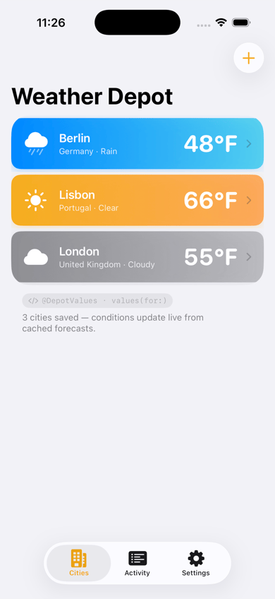
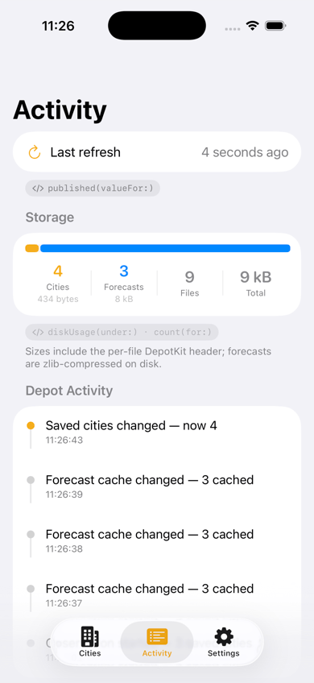
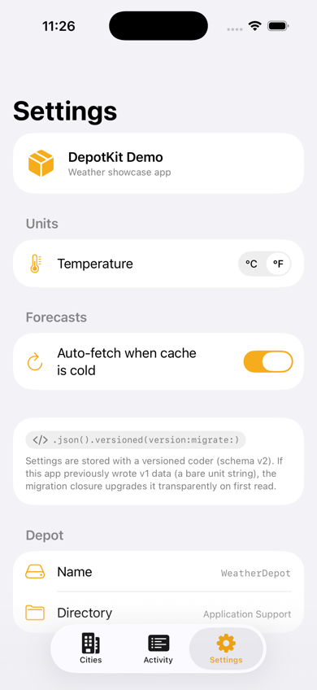

<picture>
  
</picture>

# DepotKit

**DepotKit** is a type-safe, composable key-value store for Apple platforms. Save values to disk under typed keys, work with whole families of them at once, and keep your UI in sync through `AsyncSequence`, Combine, or SwiftUI.

[](LICENSE)
[](https://swiftpackageindex.com/mercedes-benz/DepotKit)
[](https://swiftpackageindex.com/mercedes-benz/DepotKit)
[](https://swift.org/package-manager/)

```swift
import DepotKit

let depot = try Depot(name: "Weather")

// A key is a typed path plus a coder; a pattern covers a whole family of keys.
let units = depot.register(#key("preferences/units", coder: .json(UnitPreferences.self)))
let forecasts = depot.register(#pattern("forecasts/*", coder: .json(Forecast.self)))

try await depot.set(value: UnitPreferences(temperature: .celsius), for: units)
let current = try await depot.get(valueFor: units)       // UnitPreferences?

let cached = try await depot.get(valuesFor: forecasts)   // [Forecast]
try await depot.remove(valuesFor: forecasts)             // drop the whole family

// Observe: the current value first, then the latest state after each change.
for await case .success(let value) in depot.values(for: units) {
    apply(value)
}
```

## Features

For state that is too structured for `UserDefaults` but doesn't need a database — preferences, drafts, cached API responses — *DepotKit* replaces hand-rolled `Codable` + `FileManager` code:

- **Typed keys** — Keys carry their value type at compile time. No stringly-typed lookups, no force casts.
- **Key families** — Patterns such as `"users/*/settings"` or `"cache/**"` read, count, observe, and remove whole groups of values.
- **Composable coders** — JSON, property lists, raw data, and images, optionally wrapped in compression, encryption, and versioned migration.
- **Observation** — `AsyncSequence`, Combine publishers, or `@DepotValue` / `@DepotValues` for SwiftUI.
- **Transactions** — Buffered read-modify-write with rollback when the closure throws.
- **Expiry** — Per-registration lifetimes for cached data.
- **App groups** — Shared depots with cross-process change detection.
- **Memory-only mode** — The same API without disk I/O, for previews and tests.
- **No runtime dependencies** — swift-syntax is only used at build time, for the macros.

Written in **Swift 6** with *Strict Concurrency* throughout.

### When Not to Use It

- Queries over value contents, sorting, relationships, or many small records — use a database.
- Several values that must change together even across a crash, or concurrent writers in several processes — use a transactional database.
- A handful of small preferences — `UserDefaults` / `@AppStorage` is simpler.
- Secrets — use the Keychain. Large media — DepotKit reads and writes whole values in memory.

## Installation

```swift
dependencies: [
    .package(url: "https://github.com/mercedes-benz/DepotKit.git", from: "1.0.0"),
],
targets: [
    .target(name: "<your-target>", dependencies: [
        .product(name: "DepotKit", package: "DepotKit"),
        .product(name: "DepotKitCombine", package: "DepotKit"),     // optional: Combine publishers
        .product(name: "DepotKitObservation", package: "DepotKit"), // optional: SwiftUI property wrappers
    ]),
]
```

In Xcode, choose *File → Add Package Dependencies…* and enter `https://github.com/mercedes-benz/DepotKit.git`.

Requires **Swift 6.2**, iOS 17, watchOS 10, tvOS 17, macOS 14, or visionOS 1.

### Without Macros

The `#key` and `#pattern` macros come from the default `Macros` trait, which builds swift-syntax. To skip it, for example if your build policy disallows compiler plugins, disable the default traits:

```swift
.package(url: "https://github.com/mercedes-benz/DepotKit.git", from: "1.0.0", traits: []),
```

All three products stay available; see [Keys and Registration](#keys-and-registration) for declaring keys without macros.

## Usage

### Creating a Depot

A `Depot` manages one directory of values. Create one per logical store:

```swift
let depot = try Depot(name: "Weather")                            // Application Support
let cache = try Depot(directory: .caches, name: "WeatherCache")   // re-downloadable data
let ephemeral = Depot()                                           // memory-only, for previews and tests

// Shared with app extensions. In the host app, also watch for changes made by other processes:
let shared = try Depot(appGroup: "group.com.example.weather", name: "Shared")
try shared.automaticallyCheckForExternalChanges()
```

`DepotConfiguration` controls file protection, encryption, backup exclusion, read-only access, and the memory-cache size.

### Keys and Registration

Declare keys once with the `#key` and `#pattern` macros and register them when you create the depot:

```swift
enum WeatherKeys {
    static let units          = #key("preferences/units", coder: .json(UnitPreferences.self))
    static let savedLocations = #key("locations/saved", coder: .json([SavedLocation].self))
    static let lastModified   = #key("locations/lastModified", coder: .json(Date.self))
    // One pattern covers berlin/forecast, tokyo/forecast, etc.
    static let forecast       = #pattern("locations/*/forecast", coder: .json(Forecast.self))
}

let unitsKey        = depot.register(WeatherKeys.units)
let locationsKey    = depot.register(WeatherKeys.savedLocations)
let lastModifiedKey = depot.register(WeatherKeys.lastModified)
let forecastKey     = depot.register(WeatherKeys.forecast)
```

The macros validate the path syntax at compile time. Registering returns a typed handle; registering the same definition again is harmless, but keep one definition per path.

Without macros, build paths with the `/` operator, as in `depot.register(keyPath: "preferences" / "units", coder: .json(UnitPreferences.self))`, or use `KeyDefinition(path:coder:)` / `PatternKeyDefinition(path:coder:)`.

### Reading and Writing

Every operation comes in synchronous and `async` variants:

```swift
try await depot.set(value: preferences, for: unitsKey)
let stored = try await depot.get(valueFor: unitsKey)   // UnitPreferences?
try await depot.remove(valueFor: unitsKey)
```

Pattern keys operate on the whole family:

```swift
let allForecasts = try await depot.get(valuesFor: forecastKey)   // [Forecast], in no particular order
let count        = try await depot.count(for: forecastKey)
try await depot.remove(valuesFor: forecastKey)

// Address a single member of the family
let berlin = Key.from("locations" / "berlin" / "forecast", as: Forecast.self)
try await depot.set(value: berlinForecast, for: berlin)
```

`*` matches exactly one path component. `**` follows `.gitignore` rules: `users/**` covers everything below `users`, but not a value stored at `users` itself.

### Observation

`values(for:)` returns an `AsyncSequence` that starts with the current value and then delivers the latest state after each change:

```swift
for await result in depot.values(for: unitsKey) {
    if case .success(let preferences) = result {
        apply(preferences)
    }
}
```

With Combine (`DepotKitCombine`), move to the main queue before any other operator when you update UI:

```swift
let cancellable = depot.published(valueFor: unitsKey)
    .receive(on: DispatchQueue.main)
    .compactMap { try? $0.get() }
    .sink { apply($0) }
```

In SwiftUI (`DepotKitObservation`):

```swift
struct ForecastList: View {
    @DepotValue var units: UnitPreferences?
    @DepotValues var forecasts: [Forecast]

    init(depot: Depot) {
        // The definition-based initializers register the key for you.
        _units = DepotValue(definition: WeatherKeys.units, depot: depot)
        _forecasts = DepotValues(definition: WeatherKeys.forecast, depot: depot)
    }

    var body: some View {
        List(forecasts.sorted { $0.city < $1.city }, id: \.city) { forecast in
            ForecastRow(forecast: forecast, units: units)
        }
    }
}
```

### Transactions

Group a read-modify-write; if the closure throws, nothing is written:

```swift
try await depot.transaction { tx in
    var locations = try tx.get(valueFor: locationsKey) ?? []
    locations.append(SavedLocation(name: "Berlin", latitude: 52.52, longitude: 13.40))
    try tx.set(value: locations, for: locationsKey)
    try tx.set(value: Date.now, for: lastModifiedKey)
}
```

Observers are notified once per commit — a pattern observer once, not once per matching key. A transaction is not crash-atomic across files — see [Transactions](Sources/DepotKit/DepotKit.docc/Transactions.md) for the exact guarantees.

### Expiry

Give cached values a lifetime when you register them:

```swift
let hourlyForecast = depot.register(
    keyPath: "locations" / "current" / "hourly",
    coder: .json(Forecast.self),
    expiry: .seconds(30 * 60)
)
// After 30 minutes, get returns nil. Expired files are removed shortly after the depot opens,
// or when you call removeExpired().
```

### Coder Composition

Coders turn values into bytes and stack like middleware:

```swift
let coder: AnyCoder<Forecast> = .json()
    .versioned(version: 2) { data, oldVersion in
        // Migrates payloads written with an older version.
        let legacy = try JSONDecoder().decode(LegacyForecast.self, from: data)
        return Forecast(city: legacy.name, highs: legacy.highs)
    }
    .compressed(using: .lz4)
```

On write, the value is encoded as JSON, tagged with a version, then compressed; reads apply the steps in reverse. Conform to `Coder` to plug in your own.

## Example App

<p align="center">
  
  &nbsp;&nbsp;
  
  &nbsp;&nbsp;
  
</p>

[`Examples/DepotKitDemo`](Examples/DepotKitDemo) is a small SwiftUI weather app that uses every DepotKit feature: pattern keys for saved cities, cached forecasts with expiry, compressed and versioned coders, `@DepotValue` / `@DepotValues`, Combine, `AsyncSequence`, and a memory-only depot for search results.

```bash
cd Examples/DepotKitDemo
swift run DepotKitDemo   # macOS — or open DepotKitDemo.xcodeproj to run on iOS
```

## Compatibility

DepotKit follows [Semantic Versioning](https://semver.org). `DepotError` can gain cases in minor releases, so match it with a `default` clause. Newer releases read files written by older releases of the same major version; downgrading after a format change is not supported.

DepotKit does not migrate your data model: use `.versioned(version:migration:)` for schema changes, and re-write values yourself when you rename keys, change a coder, or rotate an encryption key. The [Keys and Coders](Sources/DepotKit/DepotKit.docc/KeysAndCoders.md) article shows how.

## Documentation

The API documentation and guides are written in DocC and hosted on the [Swift Package Index](https://swiftpackageindex.com/mercedes-benz/DepotKit/documentation/depotkit). Build them locally with `scripts/build-docs.sh`, or in Xcode via *Product → Build Documentation*.

## Development

```bash
scripts/setup.sh                        # once: installs the pre-commit hook (license headers, formatting)
swift build
swift test
scripts/format.sh                       # format with swift-format; --check only verifies (CI)
scripts/check-license-headers.sh --fix  # add missing SPDX license headers
```

## Contributing

We welcome contributions! Please read our [Contributing Guide](CONTRIBUTING.md). All commits must be signed off under the [Developer Certificate of Origin](https://developercertificate.org/).

## Code of Conduct

Please read our [Code of Conduct](CODE_OF_CONDUCT.md) as it is our base for interaction.

## License

This project is licensed under the [MIT License](LICENSE).

## Notice

**Source code has been tested solely for our own use cases, which might differ from yours.**

## Provider Information

Please visit <https://group.mercedes-benz.com/provider/> for provider information.
